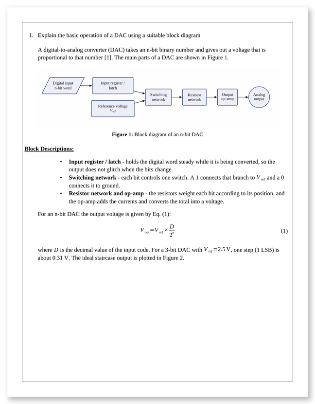
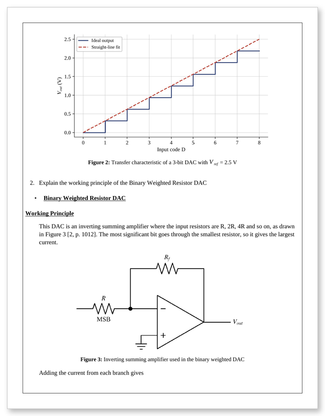
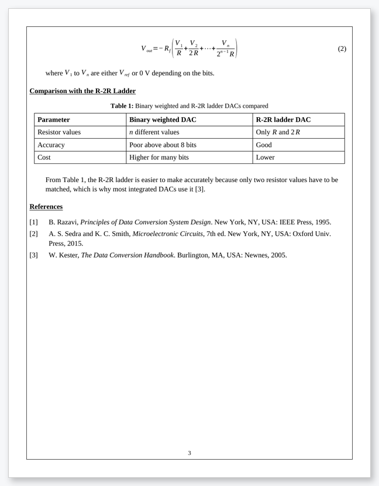
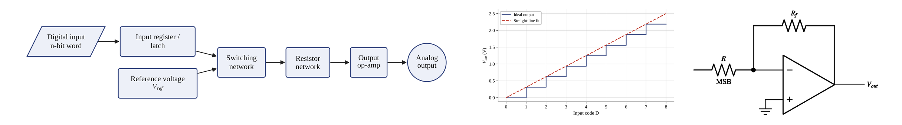

# DocumentingMCP

**Turn a chat with Claude or ChatGPT into a finished, properly formatted KDU engineering report or assignment.**

DocumentingMCP is a [Model Context Protocol](https://modelcontextprotocol.io) server for students of the
Department of Electrical, Electronic and Telecommunication Engineering at General Sir John Kotelawala
Defence University. You tell the AI what the assignment is. It writes the content, and this server
lays it out in the department's house style and saves a Word file (and a PDF if you want one).


<sub>Sample output for a made-up student, built from <a href="examples/full_assignment.md"><code>examples/full_assignment.md</code></a>
and rendered with LibreOffice. In Word, the cover uses Aptos and Agency FB.</sub>

---

## What it does

- **Asks before it writes.** It gives you a checklist of requirements to tick and the defaults to
  confirm, asks all its questions at once, and agrees a plan with you. After that it works step by
  step and checks in with you after each step.
- **House style.** It gives you the KDU cover page, page border (thickness adjustable), page numbers,
  fonts, numbering and spacing,
  measured from a real submitted assignment. Three templates are included: `assignment`
  (question and answer), `lab_report` and `ca_report`.
- **Real Word equations.** Write the maths in LaTeX, e.g. `$V_{out} = V_{ref}\frac{D}{2^n}$`, and it
  becomes a native equation you can still edit in Word. Typesetting follows the ISO convention:
  upright subscripts like V<sub>out</sub>, and units like 5 V and 10 µF.
- **Diagrams drawn for you, approved by you.** Block diagrams and flowcharts (Mermaid syntax), circuits
  and logic gates, and graphs from data, formulas or Excel/CSV files. Each one gets a critical review,
  and you approve it before it counts as final.
- **Plain Word tables.** Black grid lines and a bold header row, without the coloured "AI look".
- **IEEE references.** Write `[@key]` in the text and get [1], with the reference list built for you.
  References can be looked up from a DOI, ISBN or web link.
- **Captions and cross-references.** "Figure 2", "Table 1" and "Eq. (3)" are live Word fields.
- **Edit a section without regenerating.** Fix Question 2 or the Discussion and everything else stays put.
- **Pre-submission check.** It flags typos (British spelling is fine), "5V"-style units, placeholders
  left in, empty sections, missing questions, page limits, and **wording that sounds AI-generated**.
  A similarity check compares the report with your lecture notes.

## Sample output

| Question with a block diagram and equation | Plot, circuit and numbered figures | Table and IEEE references |
|---|---|---|
|  |  |  |

The graphs, block diagrams and circuits are generated from a few lines of text:



## Getting started (Windows)

**1. Install uv.** It is a small Python tool manager. Run this once in PowerShell:

```powershell
powershell -ExecutionPolicy ByPass -c "irm https://astral.sh/uv/install.ps1 | iex"
```

**2. Download this project:**

```powershell
cd C:\Users\User\clauderemote
git clone https://github.com/Dulaj-04/DocumentingMCP.git
cd DocumentingMCP
uv sync
```

**3. Connect it to your AI app.**

<details>
<summary><b>Claude Desktop</b></summary>

Open Settings → Developer → Edit Config and add the following, then restart Claude Desktop:

```json
{
  "mcpServers": {
    "documenting-mcp": {
      "command": "uv",
      "args": ["--directory", "C:\\Users\\User\\clauderemote\\DocumentingMCP", "run", "documenting-mcp"]
    }
  }
}
```
</details>

<details>
<summary><b>ChatGPT Desktop</b></summary>

ChatGPT only connects to MCP servers over HTTPS, so run the server in HTTP mode behind a tunnel:

```powershell
uv --directory C:\Users\User\clauderemote\DocumentingMCP run documenting-mcp --transport http --port 8000 --allowed-host YOUR-TUNNEL-DOMAIN
cloudflared tunnel --url http://localhost:8000
```

Then enable Developer mode in ChatGPT (Settings → Apps & Connectors → Advanced) and add a connector
for `https://YOUR-TUNNEL-DOMAIN/mcp`. Close the tunnel when you are done, because anyone with the URL
can use it.
</details>

**4. Ask for a document.** For example:

> Set my profile: A B C Student, D/ENG/EE/25/0000, intake 42.
> Here is my ET2013 assignment brief (C:\Users\User\Downloads\brief.pdf) and the lecture notes
> (C:\Users\User\Downloads\lecture5.pdf). Write the assignment, draw the block diagram the question
> asks for, cite the notes, then check it before saving.

The Word file is saved in `Documents\DocumentingMCP`.

## How to use it

You talk to Claude or ChatGPT normally; the AI decides which tools to call. Below are the
everyday tasks and the kind of thing to type. Paths are examples, so use your own.

### How a session goes: plan first, then step by step

Nothing is written until you have agreed a plan. Every new assignment goes like this:

1. **You describe the task.** Give the brief if you have it.
2. **You get a requirements checklist.** Tick what this assignment needs:

   - [x] Answer every question the brief asks for
   - [x] Base the theory on the lecture notes provided
   - [x] Draw diagrams wherever a question says "diagram" or "sketch"
   - [ ] Plot graphs from my readings
   - [x] Show full working for numerical questions
   - [x] IEEE references
   - [ ] Include program code
   - …

   You also see the **current defaults** and can change any of them:
   - page border: 0.5 pt, single line
   - page numbers: bottom centre
   - tables: plain Word grid
   - equation numbers, figure captions and contents page: off
   - PDF at the end: yes

   If your app supports forms, this appears as a form with real tick boxes. Otherwise it comes as a
   chat message.
3. **The AI asks all its questions in one go.** For example: module and title, submission date,
   which notes to use, where your data and photos are, word or page limits, and anything the
   lecturer asked for.
4. **You get a rough plan to approve.** For example: *1. Read brief and notes → 2. Answer Q1 with
   block diagram → 3. Answer Q2 calculation → 4. Review figures with you → 5. References and
   check → 6. Export PDF.* Say "yes", or tell it what to change.
5. **The work happens one step at a time.** After each step the AI tells you what it did, shows you
   the result and asks whether to carry on or change something.

> I need to do my ET2013 assignment on DACs. Brief: C:\Users\User\Downloads\ET2013_Assignment.pdf

> *(after the checklist)* Tick plots and code too. Make the border 1.5 pt and put the page numbers
> on the right. Due 17/05/2026, use lecture 5, no page limit.

> *(after the plan)* Looks good, go ahead.

If you really want to skip planning for a quick job, say so ("skip the planning, just write it").

### 1. First time only: save your details

> Set my profile: name **A B C Student**, reg no **D/ENG/EE/25/0000**, intake **42**.

These go on every cover page, so you won't need to type them again. You can also change the save folder:

> Save my documents to D:\Uni\Semester 3.

### 2. Write an assignment from the brief

> Here is my assignment brief: C:\Users\User\Downloads\ET2013_Assignment.pdf.
> The lecture notes are C:\Users\User\Downloads\ET2013_L5.pdf. Answer all the questions using the
> notes, and submit it on 17/05/2026.

The AI reads the brief, takes each question as a numbered heading, writes the answers in the
master assignment format and saves the Word file. Questions that say *"using a suitable diagram"*
get a drawn block diagram automatically.

### 3. Write a lab report with your own screenshots and photos

> Write my ET2263 Lab 4 report on interfacing a 16x2 LCD with STM32 over I2C.
> My screenshots and the photo of the LCD are in C:\Users\User\Desktop\Lab4.
> Here is my main.c: C:\Users\User\STM32CubeIDE\workspace\Lab4\Core\Src\main.c

The AI lists the images in the folder and places each one under the right section. It puts your code
in the Code section and writes Aim → Apparatus → Theory → Procedure → Observation → Result →
Discussion → Conclusion. If a photo is missing, it leaves a marked placeholder for you to fill in.

### 4. Add graphs from your readings or simulation data

> Use my readings in C:\Users\User\Desktop\Lab4\readings.xlsx. Put them in a table and plot
> output voltage against input code.

> For the CA report, plot torque against slip for R = 0.01 pu and 0.05 pu using the formula
> from the notes, and label the maximum torque.

Data can come from Excel/CSV columns, a list of numbers or a formula. You get labelled axes,
units and a legend. Tables are plain Word tables.

### 5. Ask for diagrams and circuits

> Draw a flowchart of the I2C scan routine.

> Draw the inverting summing amplifier with Rf in the feedback path.

> Show the control loop as a block diagram with feedback from the sensor.

Block diagrams, flowcharts, circuits and logic gates are drawn as clean figures, numbered and
captioned like the rest of the document.

### 6. Add references

> Cite the Sedra & Smith textbook (ISBN 9780199339136) and this paper: 10.1109/5.771073.
> Also add the STM32F411 datasheet from st.com.

References are saved to your library once and reused in later documents. The text gets [1], [2], …
and an IEEE reference list is built at the end. Unless you ask otherwise, only sources you actually
cite are listed.

### 7. Review and approve every figure

Generated graphs, diagrams and circuits are **not final until you approve them**. After the
document is made, the AI shows you each figure along with a critical review. The review comes from
automatic checks (axis units, text size, unlabelled branches or components, missing captions,
figures never mentioned in the text) plus the AI's own technical look at the figure.

> Show me the figures for review.

> Figure 2 is fine. In Figure 1, label the No branch and make the text bigger.

> Approve figures 1 and 3.

You can't export the PDF, and the pre-submission check won't pass, until every figure is approved.
If a figure changes after you approve it, it needs your approval again.

### 8. Change part of a document without redoing it

> In my DAC assignment, rewrite question 2 in simpler words.

> Add a short discussion about settling time after question 3.

> Change every "5V" to "5 V", remove the "Block Descriptions" part, and set the
> submission date to 20/05/2026.

Only the part you mention changes. Formatting, numbering and references update automatically.

### 9. Check it before you submit

> Check my assignment. The limit is 6 pages and 1500 words. Also compare it with the
> lecture notes for similarity.

You get a list of problems to fix:
- spelling mistakes and missing spaces in units ("5V");
- placeholders still left in, empty sections, unanswered questions and missing images;
- broken references and pages over the limit;
- **sentences that sound AI-written**, and paragraphs copied too closely from the notes.

Ask the AI to fix them, then check again.

### 10. Get the PDF

> Export it as a PDF.

With Microsoft Word installed, Word refreshes the figure numbers, cross-references and contents
first, so the PDF matches what you see in Word.

### Optional extras

Ask for these when a module wants them:

| Ask for | What you get |
|---|---|
| "add a table of contents" | Contents page after the cover (also lists of figures and tables) |
| "no page numbers" / "page numbers on the right" | Page numbers are **on by default** (bottom centre, never on the cover) |
| "make the border thicker" / "1.5 pt double border" / "no border" | Page border thickness: 0.25 to 6 pt (default 0.5 pt). Styles: single, double, thick-thin, dotted, dashed |
| "put the module code in the header" | Running header on every page except the cover |
| "number all the equations" | (1), (2), … on the right of each equation |
| "caption every figure" | "Figure n: …" under every picture |
| "use coloured tables" | Navy header with shaded rows instead of plain Word tables |

### Tips for a good result

- **Give the brief and your notes.** Answers built from your own course material read like yours.
- **Give your real results:** readings, screenshots and what went wrong in the lab. The AI is told to
  write concretely and in a student's voice, but only you know what actually happened.
- **Read and edit the output.** Treat it as a strong first draft. Make sure you understand every
  line and can explain it in a viva.
- **Keep the .docx and the `.docmcp.json` file next to each other.** The JSON file is what lets
  the AI edit sections later.

## How a document is written

The AI writes the body in Markdown. You never need to, but you can. It looks like this:

````markdown
# Explain the basic operation of a DAC using a suitable block diagram

A DAC takes an n-bit binary number and gives out a proportional voltage [@razavi1995].
The main parts are shown in @fig:block.

```{.diagram #fig:block caption="Block diagram of an n-bit DAC"}
flowchart LR
  L[Input latch] --> S[Switching network] --> R[Resistor network] --> A((Op-amp))
```

$$V_{out} = V_{ref} \times \frac{D}{2^{n}} \label{eq:dac}$$
````

- `#` is a question in assignments (numbered automatically), or a section in reports.
- `$...$` and `$$...$$` are equations.
- ```` ```plot ````, ```` ```diagram ```` and ```` ```circuit ```` are drawings.
- `[@key]` is a citation, and `@fig:x`, `@tbl:x` and `@eq:x` are cross-references.

Full examples are in [`examples/`](examples) (see its README for which ones need images). The rules the AI follows, including how to write like
a student rather than an AI, are in [`src/documenting_mcp/guides.py`](src/documenting_mcp/guides.py).

## Tools

| Area | Tools |
|---|---|
| Planning | `start_assignment` (checklist, defaults and questions), `save_plan`, `approve_plan`, `update_plan_step`, `get_plan` |
| Profile | `get_profile`, `set_profile` |
| Writing | `list_templates`, `get_writing_guide`, `create_document` |
| Your material | `extract_assignment_brief`, `read_source` (PDF/DOCX/XLSX/TXT/code), `list_files`, `spreadsheet_to_table` |
| Drawings | `make_plot`, `make_diagram`, `make_circuit` |
| References | `lookup_reference` (DOI/ISBN/URL), `add_reference`, `list_references`, `remove_reference` |
| Editing | `get_document_source`, `update_section`, `insert_section`, `delete_section`, `replace_text`, `update_document_settings` |
| Figures | `review_figures` (critique and preview), `approve_figures` (the student's approval) |
| Checking | `check_document`, `check_similarity` |
| Output | `export_pdf` (with Word installed, it refreshes all numbering first) |

**Defaults.** Nothing is written before you approve a plan. Page numbers are on (bottom centre,
never on the cover). The page border is 0.5 pt (changeable). Every generated figure needs your approval. **Optional extras:** `toc`, `list_of_figures`, `list_of_tables`, `header_text`,
`footer_text`, `figure_captions`, `number_equations` and `table_style="shaded"`.

## Good to know

- The output is a starting point. Read it, add your own results and photos, and make sure you
  understand every line before you submit.
- Reference lookup needs internet access. The similarity check only compares against the files you
  give it; it is not Turnitin.
- Aptos and Agency FB come with Word 2021 / Microsoft 365. Without them, Word substitutes similar fonts.
- **Close the document in Word before asking for changes.** Each change rebuilds the .docx. If the
  file is open, a copy named `… (new).docx` is saved instead.
- **Edits you make by hand in Word are not kept** when the AI rebuilds the document. Ask the AI to
  make changes, or do your own final touches last. Live editing of an open Word document is not
  supported yet.

## Project layout

```
src/documenting_mcp/
  server.py       MCP tools
  builder.py      Markdown → styled .docx
  styles.py       template measurements        guides.py   writing rules for the AI
  omml.py, latex_prep.py   LaTeX → Word equations
  plots.py, diagrams.py    graphs, block diagrams, circuits
  references.py   IEEE references              quality.py  checker and similarity
  project.py      section editing              ingest.py   briefs, notes, spreadsheets
  planning.py     checklist, questions, plan   figure_review.py  figure critique and approval
  fields.py       Word fields (numbering, TOC) export.py   PDF export (Word or LibreOffice)
docs/style-spec.md   the measured house style
examples/            sample documents
tests/               uv run pytest
```
