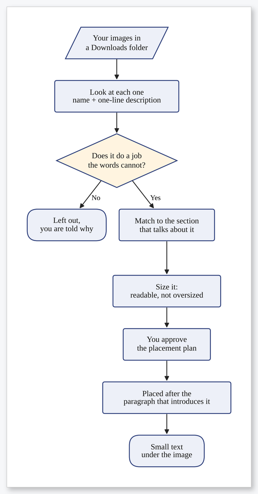
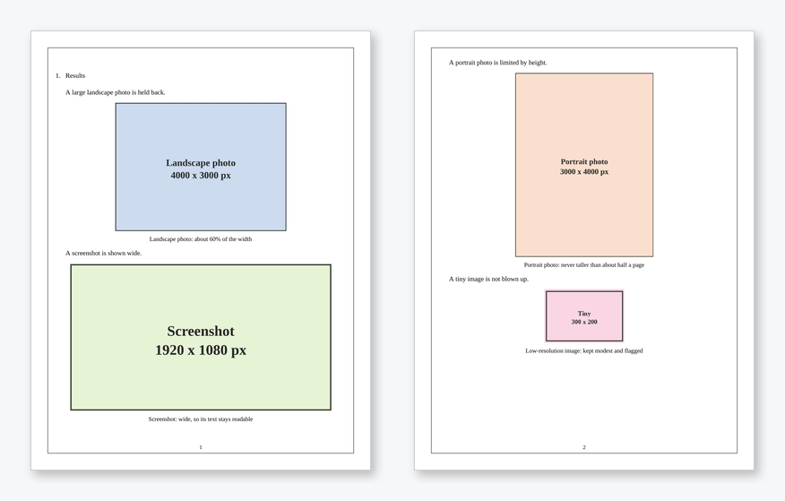
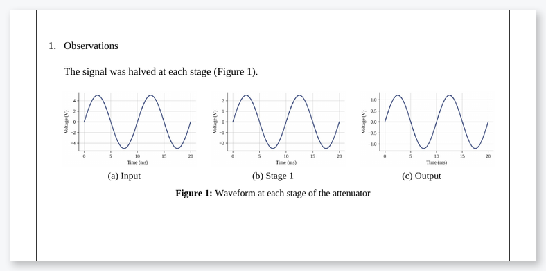
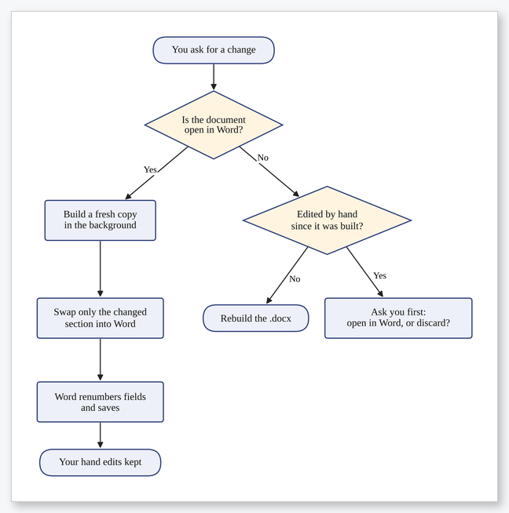

# KDocs MCP

**Turn a chat with Claude or ChatGPT into a finished, properly formatted KDU engineering report or assignment.**

KDocs MCP is a [Model Context Protocol](https://modelcontextprotocol.io) (MCP) server for students of the
Department of Electrical, Electronic and Telecommunication Engineering at General Sir John Kotelawala
Defence University. You tell the AI what the assignment is. It agrees a plan with you and writes the content
step by step, and this server lays everything out in the department's house style and saves a Word file
(and a PDF).


<sub>Sample output for a placeholder student, built from <a href="examples/full_assignment.md"><code>examples/full_assignment.md</code></a>
and rendered with LibreOffice. In Word, the cover uses Aptos and Agency FB.</sub>

> **What's new:** the AI now picks which of your images to use, sizes them so they stay readable without
> breaking the layout, places each one where it fits and adds a line of text under it
> ([images ↓](#3-lab-reports-with-your-own-screenshots-photos-and-code)). Since 1.1 it can also edit a
> document that is open in Word ([live editing ↓](#8-change-part-of-a-document)).
> [Changelog](CHANGELOG.md)

**Contents:** [Features](#features) · [How it works](#how-it-works) · [Gallery](#gallery) ·
[Getting started](#getting-started-windows) · [How to use it](#how-to-use-it) · [Tools](#tools) ·
[FAQ](#faq) · [For developers](#for-developers)

---

## Features

| | |
|---|---|
| 🗒️ **Plan first, then step by step** | It gives you a requirements checklist to tick, shows the defaults so you can change them, asks all its questions at once and agrees a plan with you. After that it checks in with you after every step. |
| 🙋 **"Get my input here"** | Tick the sections you want to contribute to. The AI asks for your real results, problems and conclusions, and builds those sections around your answers. |
| 🏛️ **KDU house style** | Cover page, page border, page numbers, fonts, spacing and question numbering, measured from a real submitted assignment. Three templates: `assignment`, `lab_report`, `ca_report`. |
| ∑ **Real Word equations** | Write LaTeX and get editable Word equations, typeset the ISO way (V<sub>out</sub>, 5 V, 10 µF), with optional numbering. |
| 📈 **Graphs, diagrams, circuits** | Drawn from a few lines of text: plots from data, formulas or Excel; block diagrams and flowcharts; circuits and logic gates. |
| ✅ **You approve every figure** | Each figure gets a critical review (units, readability, labels, captions), and none is final until you approve it. |
| 📚 **IEEE references** | `[@key]` becomes [1], and the reference list is built for you. Look references up by DOI, ISBN or web link. |
| 🔗 **Captions and cross-references** | "Figure 2", "Table 1" and "Eq. (3)" are live Word fields that update themselves. |
| ✏️ **Edit, don't regenerate** | Change one question or section; everything else stays exactly as it was. |
| 🪟 **Live editing in Word** | With the document open in Word (Windows), changes appear in the open window and your own hand edits are kept. A closed file you edited by hand is never overwritten without asking. |
| 🔍 **Pre-submission check** | Spelling (British is fine), "5V"-style units, placeholders, empty sections, missing questions, page/word limits, **AI-sounding wording**, and similarity with your lecture notes. |
| 🖼️ **Smart image use** | Works from your own image folder in Downloads. It decides which images are worth including, where each belongs, how large it should be, and adds a line of text under it. Side by side at matching heights when they belong together. |
| 🗂️ **Plain Word tables** | Black grid and a bold header, without the coloured "AI look" (a shaded style is optional). |

## How it works


The AI app (Claude Desktop or ChatGPT Desktop) does the thinking and writing. KDocs MCP gives it
**tools**: reading your brief and notes, planning, drawing, references, building the Word file and
checking it. It also gives the AI rules for writing like a student. All formatting is done by the
server, so every document comes out the same way however the AI phrases things.

<table>
<tr>
<td width="40%"></td>
<td>

### The conversation

1. **You describe the task.** Give the brief if you have one.
2. **You get a checklist.** Tick what this assignment needs, and see the current defaults: page
   border 0.5 pt, page numbers bottom centre, plain tables, and so on. Change any you like.
3. **You get all the questions in one message:** module, title, date, notes, data and photos,
   limits, and anything the lecturer asked for.
4. **You get a rough plan.** Approve it, or say what to change.
5. **You choose where to add your own input.** Each section has a "get my input here" tick box.
   Results, discussion, conclusion and similar sections are ticked by default. Before writing a ticked
   section, the AI asks you what you measured, what went wrong and what you concluded, and builds the
   section around your answers.
6. **The work happens one step at a time.** After each step you see the result and decide whether
   to carry on.
7. **You review every figure** and approve it.
8. **It runs the pre-submission check,** then exports the PDF.

In apps that support MCP forms, the checklist appears as real tick boxes. Elsewhere it appears in
the chat. You can say *"skip the planning"* for a quick job.

</td>
</tr>
</table>

## Gallery

Everything below was made by KDocs MCP's own tools. [`docs/make_images.py`](docs/make_images.py)
regenerates these pictures.

### Graphs from data, formulas or spreadsheets


<details>
<summary>The text behind the RC low-pass plot</summary>

````markdown
```{.plot #fig:bode caption="Frequency response of the RC low-pass filter"}
x_label: "Frequency (Hz)"
y_label: "Gain (dB)"
xscale: log
series:
  - {label: "$f_c$ = 1 kHz", expr: "-10*log10(1 + (f/1000)^2)", var: f, range: [10, 100000], spacing: log}
vlines:
  - {x: 1000, label: "−3 dB point"}
```
````
Data can also come from columns of an Excel or CSV file (`file: readings.xlsx`, `x: "Current (mA)"`,
`y: "Voltage (V)"`).
</details>

### Block diagrams and flowcharts


<details>
<summary>The text behind the flowchart</summary>

````markdown
```{.diagram #fig:scan caption="I2C bus scan routine"}
flowchart TD
  S([Start]) --> I[Initialise I2C]
  I --> A[Try next address]
  A --> Q{Device<br>answers?}
  Q -- No --> A
  Q -- Yes --> L[Write text to LCD]
  L --> E([End])
```
````
This is standard Mermaid flowchart syntax, laid out automatically. Feedback loops are routed around
the outside.
</details>

### Circuits and logic


<details>
<summary>The text behind the RC filter</summary>

````markdown
```{.circuit #fig:rc caption="RC low-pass filter"}
- {type: vsource, dir: up, label: "$V_{in}$", id: vs}
- {type: resistor, dir: right, label: "$R$", value: "1 kΩ"}
- {type: dot, id: n1}
- {type: capacitor, dir: down, label: "$C$", value: "160 nF"}
- {type: line, to: vs.start}
- {type: line, at: n1.center, dir: right, len: 0.6, label: "$V_{out}$", label_loc: right}
- {type: ground, at: vs.start}
```
````
Available parts: resistors, capacitors, inductors, sources, batteries, ground, op-amps, diodes, LEDs,
switches, BJTs, MOSFETs, meters, lamps, motors and AND/OR/NOT/NAND/NOR/XOR gates.
</details>

### Equations


```latex
$$V_{out} = V_{ref} \times \frac{\text{Digital Code}}{2^{n}} \tag{1}$$
$$V_{out} = -R_{f}\left(\frac{V_{1}}{R} + \frac{V_{2}}{2R} + \cdots + \frac{V_{n}}{2^{n-1}R}\right)$$
```

Descriptive subscripts (*out*, *ref*) and units are set upright automatically, and variables stay
italic. Every equation is a native Word equation, so you can click on it and edit it in Word.

### Tables and page borders


The page border can be 0.25–6 pt, in single, double, thick-thin, dotted or dashed style, or switched off.

### Pre-submission check

Example output from `check_document`:

```text
Summary: 1 380 words · 8 pages · 2 errors · 5 warnings · ready to submit: NO
 ✗ error    8 pages, which is over the 6-page limit.
 ✗ error    Figure 2 (plot) is not approved by the student yet.
 ! warning  Possible spelling mistake: 'importnt' (did you mean 'important'?)
 ! warning  Put a space between number and unit: '5 V'
 ! warning  Sounds AI-generated: crucial / pivotal / paramount used 2 time(s). Rewrite in plain words.
 ! warning  Figure 3 (diagram): Decision 'Device ready?' has unlabelled branches; label them (e.g. Yes / No).
 ! warning  First-person words (I/we/our) in 1 paragraph(s); formal reports use the passive voice.
```

## Getting started (Windows)

**1. Install uv.** It is a small Python tool manager. Run this once in PowerShell:

```powershell
powershell -ExecutionPolicy ByPass -c "irm https://astral.sh/uv/install.ps1 | iex"
```

**2. Download this project:**

```powershell
cd C:\Users\User\clauderemote
git clone https://github.com/Dulaj-04/kdocs-mcp.git
cd kdocs-mcp
uv sync
```

**3. Connect it to your AI app.**

<details>
<summary><b>Claude Desktop</b></summary>

Open Settings → Developer → Edit Config and add the following, then restart Claude Desktop:

```json
{
  "mcpServers": {
    "kdocs-mcp": {
      "command": "uv",
      "args": ["--directory", "C:\\Users\\User\\clauderemote\\kdocs-mcp", "run", "kdocs-mcp"]
    }
  }
}
```
</details>

<details>
<summary><b>ChatGPT Desktop</b></summary>

ChatGPT only connects to MCP servers over HTTPS, so run the server in HTTP mode behind a tunnel:

```powershell
uv --directory C:\Users\User\clauderemote\kdocs-mcp run kdocs-mcp --transport http --port 8000 --allowed-host YOUR-TUNNEL-DOMAIN
cloudflared tunnel --url http://localhost:8000
```

Then enable Developer mode in ChatGPT (Settings → Apps & Connectors → Advanced) and add a connector
for `https://YOUR-TUNNEL-DOMAIN/mcp`. Close the tunnel when you are done, because anyone with the URL
can use it.
</details>

**4. Start a chat:**

> I need to do my ET2013 assignment on DACs. The brief is C:\Users\User\Downloads\ET2013_Assignment.pdf
> and the notes are C:\Users\User\Downloads\ET2013_L5.pdf.

Documents are saved in `Documents\KDocs`.

## How to use it

You talk to the AI normally; it decides which tools to call. Here are the everyday tasks and the
kind of thing to type. Paths are examples, so use your own.

### 1. First time only: save your details

> Set my profile: name A B C Student, reg no D/ENG/EE/25/0000, intake 42.

These go on every cover page. You can also change the save folder:

> Save my documents to D:\Uni\Semester 3.

### 2. Start an assignment, and answer the checklist and questions

> Here is my brief: C:\Users\User\Downloads\ET2013_Assignment.pdf. Use lecture 5.

> *(after the checklist)* Tick plots and code too. Make the border 1.5 pt and put the page numbers
> on the right. Due 17/05/2026, no page limit.

> *(after the plan)* Get my input for the Result, Discussion and Conclusion only. Looks good, go ahead.

> *(before the Result section)* LCD showed "KDU UNIVERSITY" on line 1. The first try failed because I
> shifted the address twice; it worked at 0x48.

Every question in the brief becomes a numbered heading in the master assignment format. Questions
that say *"using a suitable diagram"* get a drawn diagram.

### 3. Lab reports with your own screenshots, photos and code

> Write my ET2263 Lab 4 report on interfacing a 16x2 LCD with STM32 over I2C. My screenshots and the
> photo of the LCD are in C:\Users\User\Desktop\Lab4, and the code is
> C:\Users\User\STM32CubeIDE\workspace\Lab4\Core\Src\main.c

The images go under the right sections, the code goes in the Code section, and missing photos are
left as marked placeholders. The sections run Aim → Apparatus → Theory → Procedure → Observation →
Result → Discussion → Conclusion.

**The AI decides which images to use, and where.** It works from your own image folder in Downloads
(the default is `Downloads\KDocs Images`; tell it if you made a folder of your own and it remembers).

<table>
<tr>
<td width="38%"></td>
<td>

1. It looks at each image, gives it a descriptive name (`rc-filter-circuit.png`, not `IMG_2041.jpg`)
   and records one sentence about what it shows. If it can't tell, it asks you.
2. It decides **whether** an image belongs. An image has to do a job the words can't, such as showing
   the setup, a measured result or a circuit. Unrelated images are left out, and it tells you which.
3. It decides **where**. It matches what each image shows with what each section says, then puts the
   image straight after the paragraph that introduces it. Setup photos go under Apparatus or
   Procedure, scope screenshots under Observations, circuit diagrams under Theory, and so on.
4. It shows you the plan (image → section → after which paragraph) and places the images once you agree.
5. Every image gets **a small line of text below it** saying what it shows, and the text mentions the
   image before it appears ("as shown in Figure 2").

</td>
</tr>
</table>

> My lab photos are in Downloads\ET2013 Lab 4. Use whichever ones fit the report and put each one
> where it belongs. Show me the plan first.

> Put the two scope screenshots side by side under Observations.

> Rename the second photo to "dac-output-5v" and update the report.

**Sizing: not too small, not too large.** Each image is sized for what it is:

| Image | Shown as |
|---|---|
| Screenshot, graph or diagram | Wide (about 95% of the text width), so small text stays readable |
| Landscape photo | About 60% of the width |
| Portrait or square photo | Limited by height, so it never takes over the page |
| Anything | Never taller than about half a page, and never enlarged until it turns blurry |
| Low-resolution image | Kept at a sensible size and **flagged**, so you can supply a bigger original |

<p align="center"></p>

<sub>The same report with four kinds of image: each gets its own size, a line of text underneath, and its introducing sentence stays with it.</sub>

You can also ask for a size: `{width=small|medium|large|full}` or a percentage. An over-tall size
is reduced automatically and reported. In a side-by-side row, a warning appears if a screenshot is
too small to read, and the AI is told to use two per row instead of three.

Your original files are never moved or deleted. Reports find images by file name, so one image can be
used in several places.

<p align="center"></p>

<sub>Three images written on one line. They get the same height, (a)/(b)/(c) labels and one shared caption.</sub>

- **Alignment:** a single image is centred and sized to fit. Two or three images on one line sit side
  by side at the same height, with (a), (b) labels under each and one shared "Figure n" caption.
- **Renaming** works on files inside the image folder only, and can update a report that already uses
  the image, so nothing breaks.
- Phone photos are turned the right way up automatically.

### 4. Graphs and tables from your data

> Use my readings in C:\Users\User\Desktop\Lab4\readings.xlsx. Put them in a table and plot output
> voltage against input code.

> Plot torque against slip for R = 0.01 pu and 0.05 pu using the formula from the notes, and mark
> the maximum torque.

### 5. Diagrams and circuits

> Draw a flowchart of the I2C scan routine.

> Draw the inverting summing amplifier with Rf in the feedback path.

### 6. References

> Cite the Sedra & Smith textbook (ISBN 9780199339136) and the paper 10.1109/5.771073. Also add the
> STM32F411 datasheet from st.com.

References are saved to a library and reused in later documents. Only sources you actually cite
are listed.

### 7. Review and approve every figure

> Show me the figures for review.

> Figure 2 is fine. In Figure 1, label the No branch and make the text bigger.

> Approve figures 1 and 3.

You can't export the PDF until every figure is approved. If a figure changes after you approve it,
it needs approving again.

### 8. Change part of a document

> Rewrite question 2 in simpler words.

> Add a short discussion about settling time after question 3.

> Change every "5V" to "5 V", remove the "Block Descriptions" part, and set the date to 20/05/2026.

Only the part you name changes. The rest of the document stays exactly as it was.

#### Editing while the document is open in Word

<table>
<tr>
<td width="45%"></td>
<td>

> Open it in Word.

Leave it open, keep polishing it by hand, and ask for changes in the chat as usual. With desktop Word
on Windows (2013, 2016, 2019, 2021, 2024 or Microsoft 365):

- the changed section is built in the background and **swapped into the open window**;
- Word renumbers figures, tables, equations and cross-references, then saves;
- **anything you typed by hand elsewhere stays**;
- the PDF is exported from the same window.

If the file is closed and you have edited it by hand since it was generated, the AI **stops and asks
you** whether to open it in Word (keeping your edits) or rebuild it (losing them).

Changes to the whole document (cover details, border, page numbers) need the file closed.

</td>
</tr>
</table>

| What you ask for | Document open in Word | Document closed |
|---|---|---|
| Rewrite / add / remove a section | Applied live, hand edits kept | Rebuilt (asks first if you edited it by hand) |
| Find and replace | Done by Word itself | Rebuilt (asks first if you edited it by hand) |
| Cover, border, page numbers | Close the file first | Rebuilt |
| Export PDF | From the open window | Word in the background (or LibreOffice) |

### 9. Check it, then get the PDF

> Check my assignment. The limit is 6 pages and 1500 words. Compare it with the lecture notes too.

> Export it as a PDF.

With Microsoft Word installed, Word refreshes the figure numbers, cross-references and contents
before the PDF is made.

### Options you can ask for

| Ask for | What you get |
|---|---|
| "page numbers on the right" / "no page numbers" | Page numbers are on by default (bottom centre, never on the cover) |
| "1.5 pt double border" / "no border" | Page border 0.25–6 pt (default 0.5 pt); single, double, thick-thin, dotted or dashed |
| "add a table of contents" | Contents page after the cover (lists of figures and tables too, if you ask) |
| "put the module code in the header" | Running header on every page except the cover |
| "number all the equations" | (1), (2), … on the right |
| "caption every figure" | "Figure n: …" under every picture |
| "use coloured tables" | Navy header with shaded rows |

### Tips for a good result

- **Give the brief and your notes.** Answers built from your own course material read like yours.
- **Give your real results:** readings, screenshots and what went wrong in the lab. Only you know
  what actually happened.
- **Treat the output as a strong first draft.** Read it, and make sure you can explain every line.
- **Polish by hand with the file open in Word** (Windows), so later AI changes don't touch your edits.
- **Keep the `.docx` and its `.kdocs.json` file together.** The JSON file is what lets the AI
  edit sections later.

## Tools

The AI calls these for you. The list shows what the server can do.

| Area | Tool | What it does |
|---|---|---|
| Planning | `start_assignment` | Requirements checklist, defaults to confirm, and every open question (as a form when the app supports it) |
| | `save_plan`, `approve_plan` | Store your answers and the step plan; approval needs your own words |
| | `update_plan_step`, `get_plan` | Track progress and check in with you after each step |
| | `ask_section_input`, `save_section_input` | "Get my input here": ask you about a ticked section, and keep your answers word for word |
| Profile | `get_profile`, `set_profile` | Name, reg no, intake and output folder, stored once |
| Writing | `list_templates`, `get_writing_guide` | Templates, and the writing rules (house style, student voice) |
| | `create_document` | Build the Word file (only once a plan is approved) |
| Your material | `extract_assignment_brief` | Pull the module, title, date, instructions, questions and marks from a brief |
| | `read_source`, `list_files` | Read PDF/DOCX/XLSX/text/code; list your photos and screenshots |
| | `import_images`, `list_images`, `describe_image`, `rename_image` | Collect images from your Downloads folder, name them by content, record what each shows, rename later (reports are updated) |
| | `suggest_image_placement`, `place_image` | Decide which images belong and where, then insert them after the right paragraph with a line of text below |
| | `spreadsheet_to_table` | Excel/CSV readings → table |
| Drawings | `make_plot`, `make_diagram`, `make_circuit` | Preview a graph, block diagram or circuit |
| Figures | `review_figures`, `approve_figures` | Critical review of each figure, and your approval |
| References | `lookup_reference`, `add_reference`, `list_references`, `remove_reference` | IEEE reference library, filled by DOI, ISBN or URL |
| Editing | `get_document_source`, `update_section`, `insert_section`, `delete_section`, `replace_text`, `update_document_settings` | Change parts of a document without regenerating it |
| | `open_in_word` | Open the document in Word (Windows) so later changes are applied live, keeping your hand edits |
| Checking | `check_document`, `check_similarity` | Pre-submission check, and comparison with your sources |
| Output | `export_pdf` | PDF, with Word refreshing all fields first |

## FAQ

**Which apps does it work with?**
Claude Desktop (directly) and ChatGPT Desktop (through an HTTPS tunnel). Any other app that supports
MCP servers should also work.

**Which Word versions open the files?**
Any recent Word: 2013 or later, Microsoft 365, Word for Mac and Word for the web. The equations and
numbering are standard Word features. The cover fonts (Aptos, Agency FB) come with Word 2021 and
Microsoft 365, and older versions substitute similar fonts.

**Can it edit a document that is open in Word?**
Yes, with desktop Word on Windows (Word 2013, 2016, 2019, 2021, 2024 and Microsoft 365). Ask *"open
it in Word"*, or open it yourself. While it is open, section changes and find-and-replace go straight
into the open window: only the changed part is swapped, Word renumbers figures and cross-references
and saves, and everything you typed by hand elsewhere stays. Changes that touch the whole document
(cover details, border, page numbers) still need the file closed.

When the file is closed and you have edited it by hand since it was generated, the AI stops and asks
before rebuilding, so your edits are never lost silently. Word for Mac and Word for the web are not
supported for live editing; close the file there before asking for changes.

**Does it need the internet?**
Only to look up references by DOI, ISBN or URL. Everything else, including drawing and checking, runs
on your PC.

**Is the similarity check like Turnitin?**
No. It only compares the report with the files you give it, such as lecture notes, papers or a
classmate's report. It catches close copying from those files before you submit.

**Is it allowed to use this for coursework?**
That depends on your module's rules on AI tools. Check with your lecturer. KDocs MCP is built to
help you produce *your* work: it plans with you, asks for your results, makes you approve figures, and
flags text that reads as machine-written. Make sure you understand and can defend everything you submit.

## For developers

```bash
uv sync
uv run pytest                    # tests
uv run python docs/make_images.py  # regenerate the README pictures (needs LibreOffice + poppler)
```

```
src/kdocs_mcp/
  server.py         MCP tools and the plan-first workflow
  planning.py       checklist, questions and plans    builder.py    Markdown → styled .docx
  styles.py         template measurements             guides.py     writing rules for the AI
  omml.py, latex_prep.py   LaTeX → Word equations     fields.py     Word fields (numbering, TOC)
  plots.py, diagrams.py    graphs, diagrams, circuits figure_review.py  figure critique and approval
  references.py     IEEE references                   quality.py    pre-submission and similarity checks
  project.py        section editing                   ingest.py     briefs, notes, spreadsheets
  export.py         PDF export (Word or LibreOffice)  live_word.py  live editing through Word's COM interface
docs/style-spec.md  the measured house style
examples/           sample documents (see examples/README.md)
tests/              uv run pytest
```
